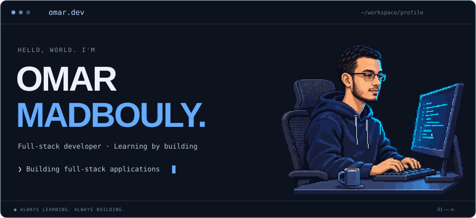
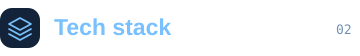
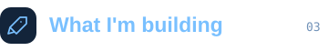
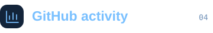
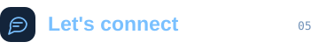

### 👨‍💻 About me

> **Curious mind. Connected systems.** 
> *Learning by building, one project at a time.*

🎓 &nbsp; Computer Science graduate focused on **full-stack development**.

🛠️ &nbsp; I learn best by **building projects** and **solving problems**.

💡 &nbsp; Always curious about **how things work** — and how to build them.

<h3></h3>

<h3></h3>

<h3></h3>

  
  

<h3></h3>

**Good things start with a conversation.**

---

Built with curiosity ✦ · [OmarMadbouly0](https://github.com/OmarMadbouly0)
