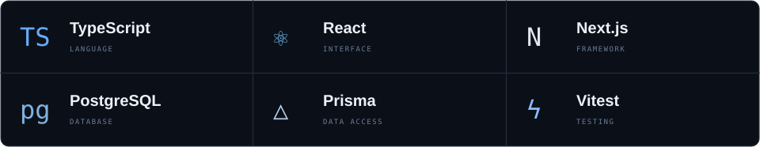

<samp>HELLO, WORLD. I'M</samp>

<h1>Omar <a href="https://github.com/OmarMadbouly0">Madbouly.</a></h1>

<h3><samp>FULL-STACK DEVELOPER</samp></h3>

<em>Learning by building.</em>

  Currently building <a href="https://github.com/OmarMadbouly0/greenz"><strong>GreenZ</strong></a> 🌱 
  <samp>Next.js · TypeScript · PostgreSQL</samp>

<code>❯ Always learning. Always building.</code>

 

### 01 / ABOUT

**Curious mind. Connected systems.**

Computer Science graduate focused on **full-stack development**.

I learn best by building projects, solving problems, and figuring out how things work.

### 02 / STACK

### 03 / BUILDING

### 04 / GITHUB STATS

  
  

### 05 / CONNECT

**Good things start with a conversation.**

---

Built with curiosity ✦ · [OmarMadbouly0](https://github.com/OmarMadbouly0)
