<table width="100%">
  <tr>
    <td width="60%" valign="middle">
      
<samp>omar.dev / ~/workspace/profile</samp>

      
HELLO, WORLD. I'M

      <h1>OMAR <a href="https://github.com/OmarMadbouly0">MADBOULY.</a></h1>
      
<strong>Full-stack developer</strong> Learning by building

      
<code>❯ Building full-stack applications</code>

      
🔵 ALWAYS LEARNING. ALWAYS BUILDING.

    </td>
    <td width="40%" align="center" valign="middle">
      
    </td>
  </tr>
</table>

### 01 / ABOUT

**Curious mind. Connected systems.**

Computer Science graduate focused on **full-stack development**.

I learn best by building projects, solving problems, and figuring out how things work.

### 02 / STACK

### 03 / BUILDING

### 04 / GITHUB STATS

  
  

### 05 / CONNECT

**Good things start with a conversation.**

---

Built with curiosity ✦ · [OmarMadbouly0](https://github.com/OmarMadbouly0)
